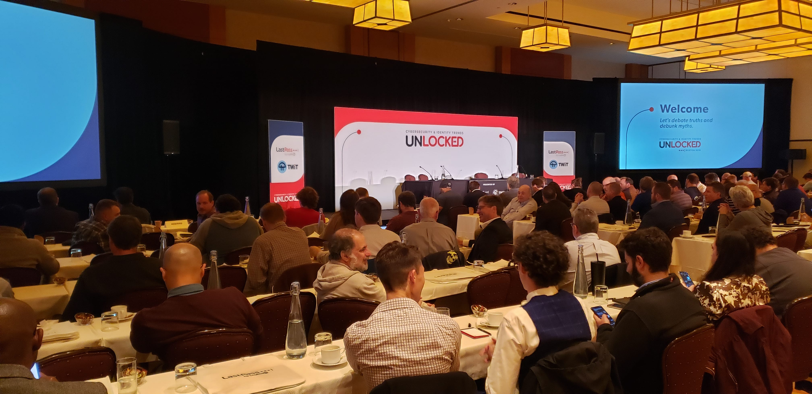
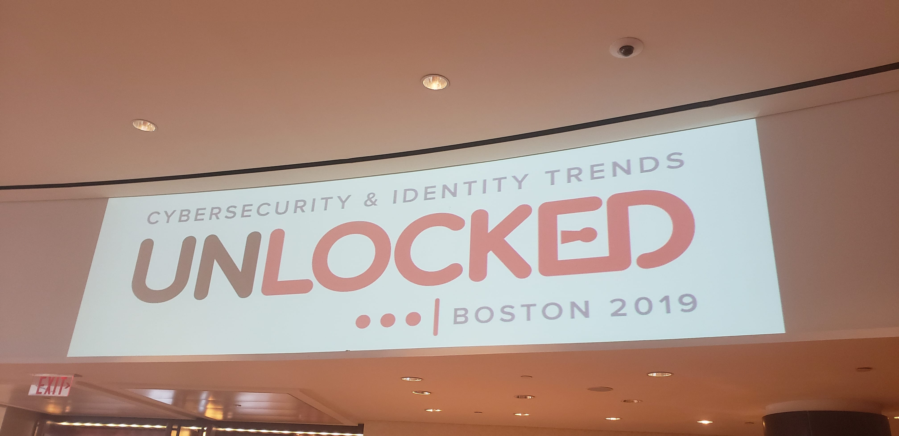
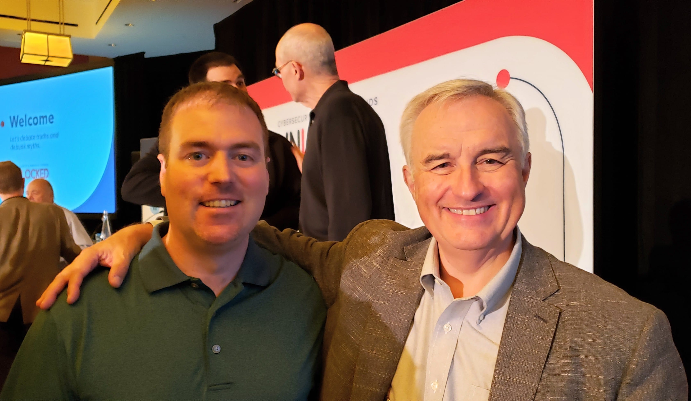
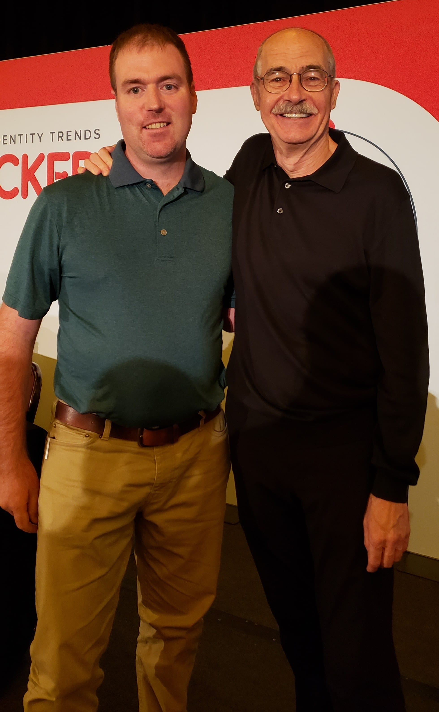

Last Thursday, October 3, 2019 I had an opportunity to attend **LastPass’s Unlocked** – **Cybersecurity & Identity Trends** event in Boston, MA.

The panel of security experts included:

- [**Bill Cheswick**](https://web.archive.org/web/20250125062408/http://cheswick.com/ches/index.html), Computer Security and Networking Researcher
- **Gerald Beuchelt**, Chief Information Security Officer/Vice President for LogMeIn
- **[Steve Gibson](https://web.archive.org/web/20250125062408/https://www.grc.com/)**, Software Engineer, Security Researcher, and Host of the Security Now Podcast. [grc.com](https://web.archive.org/web/20250125062408/https://www.grc.com/)

I’m a big fan of [Twit.tv](https://twit.tv/), Leo Laporte, Steve Gibson and I use LastPass every day. So I was really excited to attend the event knowing I’d be participating in an engaging and fun conversation around security, passwords, and learn more about Steve’s solution for passwords, the [SQRL project](https://web.archive.org/web/20250125062408/https://www.grc.com/sqrl/sqrl.htm).

The full-length video of the discussion is available on YouTube, which I’ve embedded below.

https://youtu.be/tiiAS5mmtCA?si=gDBPeamz063azExm

