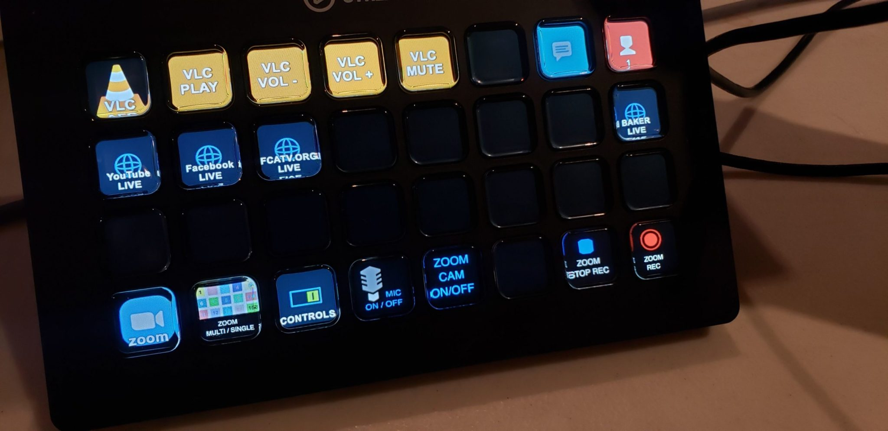
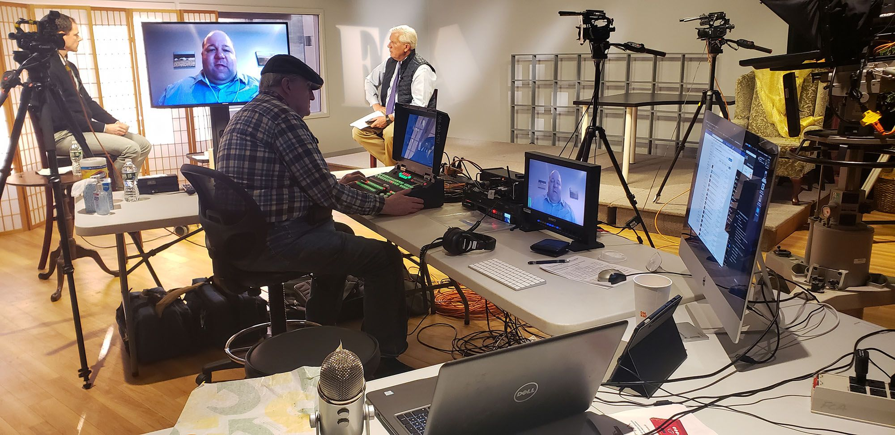
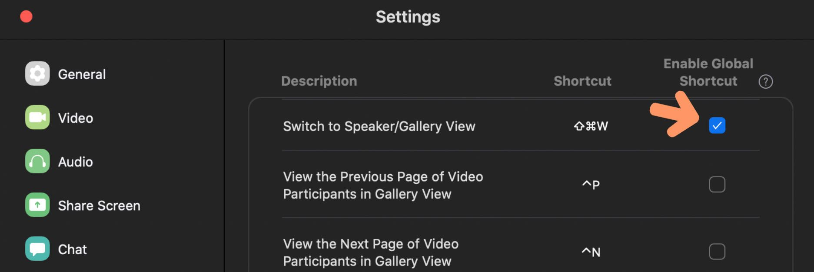

**UPDATE:** My setup for Zoom has evolved and somewhat less dependent on StreamDeck now. [You may want to check out my new Blog Post with our updated Zoom setup for TV interviews](https://www.michael-webber.com/zoom-tv-interviews/).

This week I purchased a [Stream Deck XL](https://www.elgato.com/en/gaming/stream-deck-xl) ($235) to help streamline our video productions with Zoom remote guests.

Since the COVID-19 crisis hit mid-March our community television station scrambled to adapt and help disseminate important information. [Zoom](https://www.zoom.us/) quickly became the go-to platform for setting up meetings and remote show guests.

In the past few weeks, we’ve produced more than a dozen programs using Zoom. Initially, we had an in-studio host and multiple remote guests displayed on an in-studio monitor. Now, most of our interview shows a produced entirely on Zoom.

Despite the limitations, we are making every effort to maintain high production values, focusing on:

- Good Clean Audio
- Well Composed Shots (eyes on the upper third!)
- Shot sequencing, Close Ups / Multi-Box Switching
- Graphics, Lower Thirds, Etc.
- Open/Close Music
- Still Store for Inserts

Our existing television studio was not set up well for the shift in production style. This prompted us to build a temporary video production console on several folding tables right inside our studio.

## Adding Steam Deck XL into the Workflow

Using the Zoom keyboard shortcuts certainly helps the production value. I find myself using Shift-Command-W (Mac) constantly to switch between Speaker view and Gallery View in Zoom. To me that’s the key to using zoom for video production. You can force a better cadence of switching that matches the conversation.

I do wish there was a way within Zoom that I could force a certain camera view to appear full screen, similar to the normal workflow of a video production switcher. Zoom does offer a “spotlight video” option which does this, but it’s not mapped to a keyboard shortcut and requires too many mouse clicks to make it useful.

Another shortcut I use often hides the control panel buttons on the lower part of the screen.

The **Stream Deck XL** simply automates the keyboard shortcut process and reduces keystrokes to a single button. Allowing new users in the video production environment to get up to speed faster and with better results.

### TIP – ENABLE GLOBAL SHORTCUT

Enabling global shortcuts really helps the Stream Deck configuration. This setting allows the shortcuts to work even when Zoom is not in focus.

We’re also using VLC shortcuts to play intro/outro music.

Bottom row of buttons on our Stream Deck are all shortcuts for Zoom.

Then I added several shortcuts to websites we use for our live broadcasts.

A work in progress, but thought I’d share what we have setup so far. If you’re using Stream Deck for video production I’d be curious to hear your use case.
