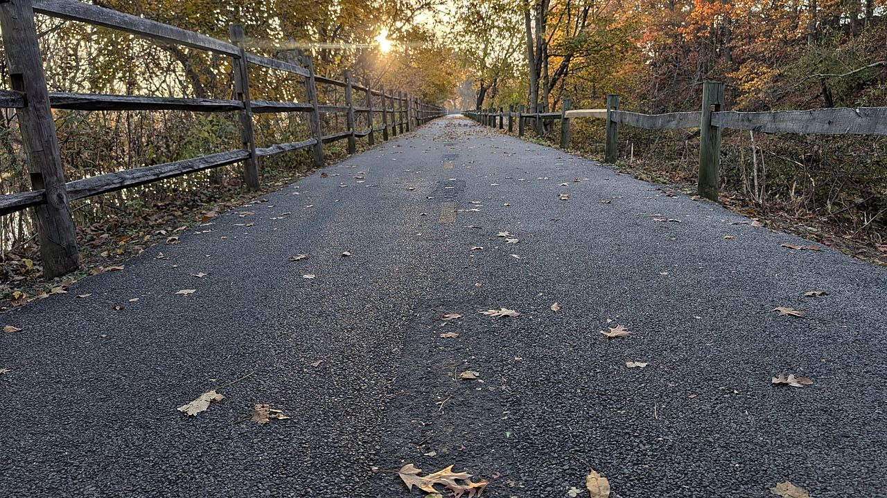

Sometimes a small victory is just getting up early and getting a run in, enjoying the mild early November temperatures along the Blackstone and the last waning days of fall foliage.

It is also the morning after the midterm elections. The country made some decisive decisions yesterday about the direction it wants to go, and I found myself thinking about that out on the path. What it will mean for the remainder of the Trump presidency, and in the larger context, how it shifts the direction of the United States, in this year when we just celebrated its 250th anniversary this past summer.

Like a lot of runners, I find an early morning run in the crisp, cool air an opportunity to think, to have a moment to yourself. This morning there was plenty to think about.
